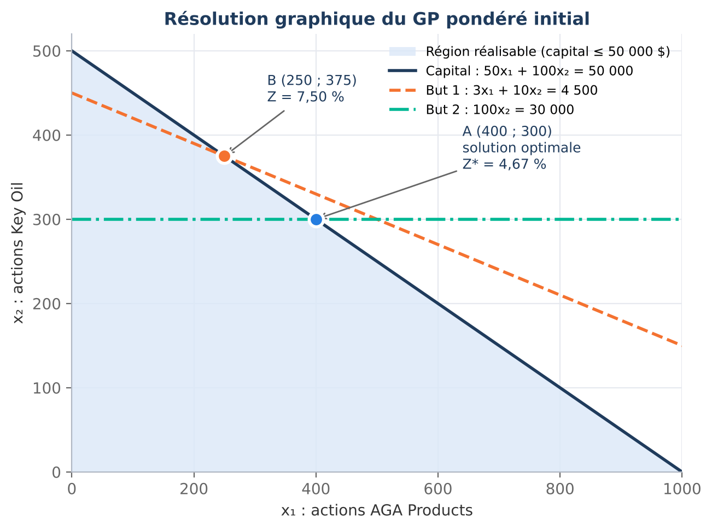
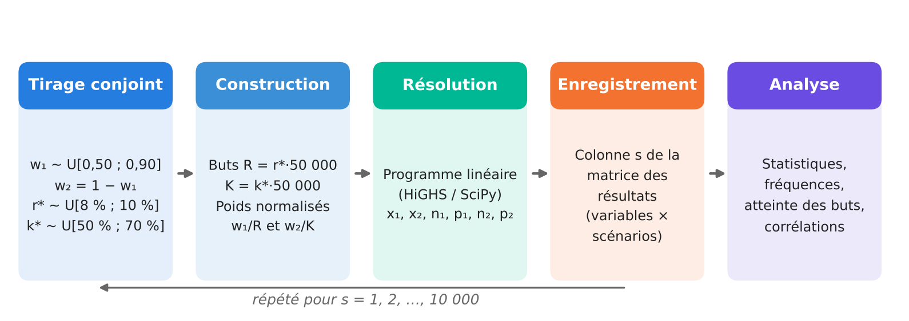
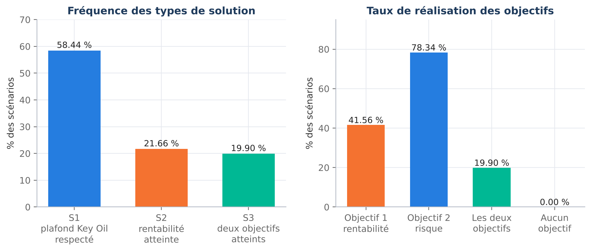
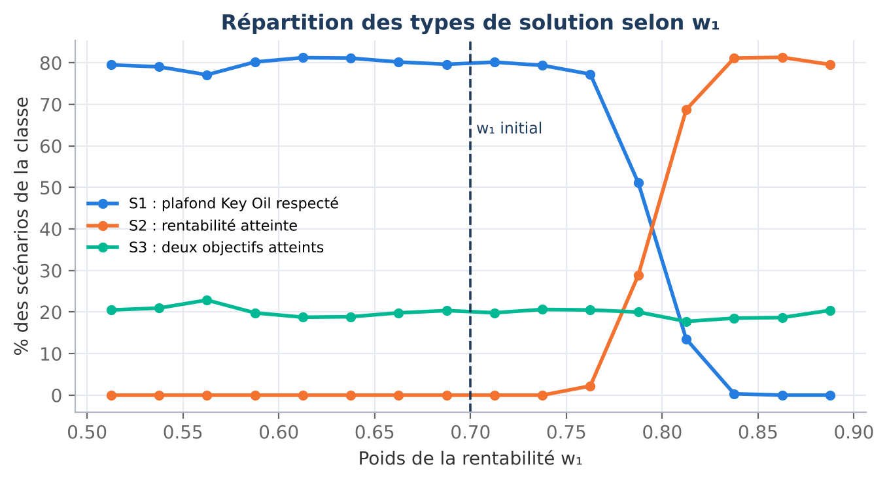
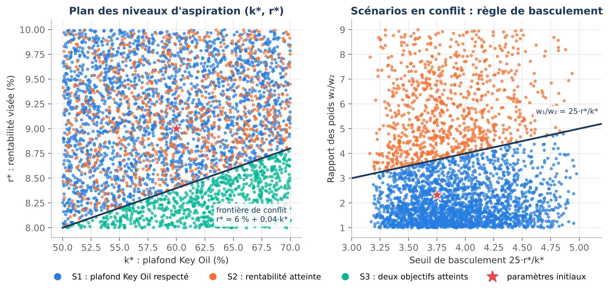

# Programmation par objectifs pondérée et analyse de robustesse par Monte-Carlo (Python)

Projet de **Decision Engineering**, Master Data Science for Business & Economics, IHEC Sfax (novembre 2026).
Encadrant : M. Ayman Boujelben.

## Le problème

Un investisseur dispose de **50 000 $** à répartir entre deux actions :

| Action | Prix | Rentabilité annuelle estimée |
|---|---|---|
| AGA Products (x₁) | 50 $ | 6 % |
| Key Oil (x₂) | 100 $ | 10 % |

Il poursuit **deux objectifs en conflit** :
1. **Rentabilité** : atteindre un rendement r* (9 % du capital) ;
2. **Risque** : ne pas investir plus de k* (60 %) du capital dans Key Oil, l'action la plus risquée.

Plus de Key Oil augmente le rendement mais dépasse le plafond de risque : il faut arbitrer.

## Le modèle : Goal Programming pondéré

Les écarts indésirables (n₁ : rendement manquant, p₂ : dépassement du plafond Key Oil) sont **normalisés par leur but**, pour être exprimés en % et rendus comparables :

```
min Z = 100 × [ w1 · n1 / R  +  w2 · p2 / K ]

s.c.  50 x1 + 100 x2              ≤ 50 000     (capital)
       3 x1 +  10 x2 + n1 − p1    = R          (but 1 : R = r* × 50 000)
              100 x2 + n2 − p2    = K          (but 2 : K = k* × 50 000)
       x1, x2, n1, p1, n2, p2 ≥ 0
```

Résolution avec `scipy.optimize.milp` (solveur HiGHS).

## Solution initiale (w₁ = 0,70 ; w₂ = 0,30 ; r* = 9 % ; k* = 60 %)



| Résultat | Valeur |
|---|---|
| AGA Products | **400 actions** (20 000 $) |
| Key Oil | **300 actions** (30 000 $) |
| Rendement | 4 200 $ (8,4 %), contre 4 500 $ visés |
| Part Key Oil | 60 % : plafond respecté |
| Z* | 4,67 % |

Le modèle privilégie le respect du plafond de risque et accepte un rendement inférieur de 300 $ au but.

## Analyse de robustesse : 10 000 simulations de Monte-Carlo

Les paramètres varient **simultanément** dans chaque scénario :
w₁ ~ U[0,50 ; 0,90] (w₂ = 1 − w₁), r* ~ U[8 % ; 10 %], k* ~ U[50 % ; 70 %].



### Résultats



- La solution exacte (400 ; 300) n'est retrouvée que dans **0,66 %** des scénarios : les quantités sont sensibles aux paramètres.
- Mais la **même logique de décision** (Key Oil au plafond, le reste en AGA) reste optimale dans **78,3 %** des scénarios.
- Objectif de rentabilité atteint dans **41,6 %** des scénarios, plafond de risque dans **78,3 %**, les deux à la fois dans **19,9 %**.
- **k*** est le paramètre qui pèse le plus sur la composition du portefeuille (corrélation de Spearman avec x₂ : 0,70).

### Règle de basculement



Lorsque les deux objectifs sont en conflit, le modèle passe de « respecter le plafond de risque » à « atteindre la rentabilité » quand :

```
w1 / w2  >  25 · r* / k*
```

Cette règle, dérivée analytiquement, concorde avec la solution du solveur dans **100 %** des scénarios en conflit. Avec les paramètres initiaux (r* = 9 %, k* = 60 %), le seuil vaut 3,75, soit une bascule pour **w₁ > 0,79**. Dans les simulations, aucun scénario ne bascule tant que w₁ reste inférieur à 0,76 environ.



### Pourquoi normaliser les écarts ?

Sans normalisation, l'écart de rendement (en $ de gain) et l'écart d'investissement Key Oil (en $ investis) ne sont pas à la même échelle : les poids n'auraient alors **aucun effet** entre 0,50 et 0,90 (il faudrait w₁ > 0,96 pour changer de solution). La comparaison des deux versions est détaillée dans la section 5.5 du rapport.

## Contenu du dépôt

| Fichier | Description |
|---|---|
| `gp_modele.py` | Formulation et résolution du GP pondéré |
| `monte_carlo.py` | 10 000 simulations, statistiques, types de solution, corrélations |
| `graphiques.py` | Génération des 11 figures (`fig01` à `fig11`) |
| `export_excel.py` | Export de la matrice 17 × 10 000 et des synthèses |
| `resultats_monte_carlo.xlsx` | Classeur Excel des résultats |
| `solution_initiale.txt`, `sortie_console_monte_carlo.txt` | Sorties du modèle initial et de la simulation |
| `Rapport_GP_Monte_Carlo.pdf` | Rapport complet |

## Reproduire

```bash
pip install -r requirements.txt
python gp_modele.py      # modèle initial
python monte_carlo.py    # 10 000 simulations (graine 2026)
python graphiques.py     # figures
python export_excel.py   # classeur Excel
```

**Outils :** Python, NumPy, SciPy (HiGHS), pandas, Matplotlib, openpyxl.

---
Hechmi Rekik · [LinkedIn](https://www.linkedin.com/in/hechmi-rekik-75931642b/)
